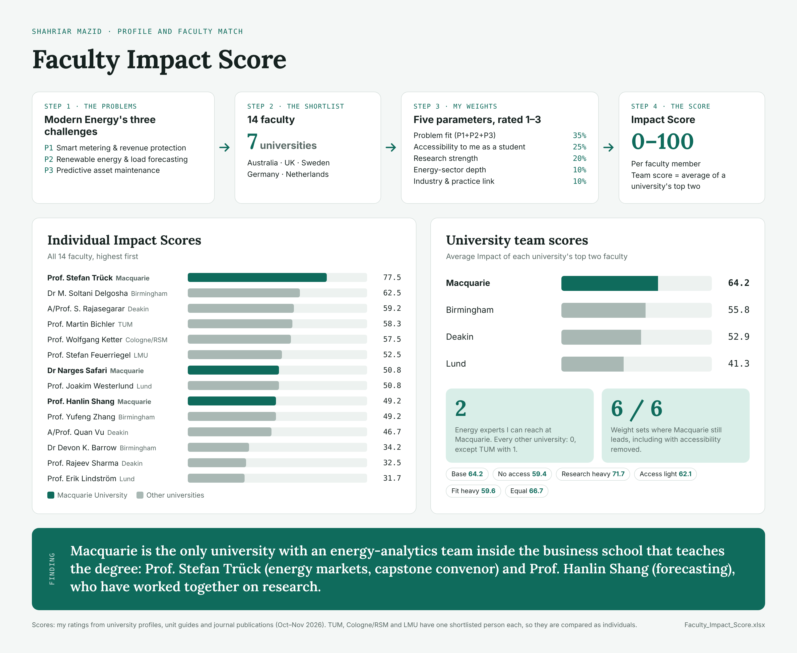

# Faculty Impact Score

**Matching my profile and career goals to business analytics faculty before choosing a university**

## Why I built this

I work as Business Development Manager at Modern Energy Co. Ltd., a Bangladeshi manufacturer of prepaid smart meters, LED lighting and solar/battery products. After my master's, I will return to the company to apply analytics to three problems:

| | Goal | What it means |
|---|---|---|
| P1 | Meter fraud detection | Use machine learning and anomaly detection on smart meter data to find unauthorised consumption and revenue leakage |
| P2 | Load forecasting | Forecast peak demand from weather and usage history, and plan solar integration |
| P3 | Asset maintenance | Use sensor and operational data to predict equipment failures |

Before choosing a university, I wanted to know where I could learn from faculty whose expertise matches these goals, and whom I could realistically reach as a master's student.

## What I did

1. **Shortlisted 14 business analytics academics** at 7 universities in Australia, the UK, Sweden, Germany and the Netherlands.
2. **Rated each person from 1 (weak) to 3 (strong)** on five parameters, using their university profiles, unit guides and journal publications.
3. **Combined the ratings into a weighted score from 0 to 100.**
4. **Compared universities as teams**, using the average of each university's top two faculty, since I would realistically work with one or two people.
5. **Tested six different weightings** to check that the result does not depend on my choice of weights.

| Parameter | Weight | Question it answers |
|---|---|---|
| Problem fit (P1 + P2 + P3) | 35% | How closely does their published work match my three goals? |
| Accessibility | 25% | Could I realistically learn from them in a business analytics master's? |
| Research strength | 20% | How strong is their journal record? |
| Energy-sector depth | 10% | Is energy a core part of their research? |
| Industry and practice link | 10% | Do they work with industry, startups or policy makers? |

## Result

| University | Team score (0–100) | Reachable energy experts |
|---|---|---|
| **Macquarie University** | **64.2** | **2** |
| University of Birmingham | 55.8 | 0 |
| Deakin University | 52.9 | 0 |
| Lund University | 41.3 | 0 |

Macquarie ranked first under all six weightings I tested, including one that ignores accessibility completely.

**The main reason is a team, not one person.** Macquarie's business school, which delivers the Master of Business Analytics, has two energy-analytics experts who have worked together on research:

- **Prof. Stefan Trück**, Director of the Transforming Energy Markets Research Centre, who has convened the degree's capstone unit (BUSA8031)
- **Prof. Hanlin Shang**, a forecasting specialist who has co-authored research on forecasting Australian electricity generation with Prof. Trück

Prof. Trück also has the highest individual score of all 14 academics (77.5).

## Where Macquarie is weaker

Meter fraud detection (P1). Faculty at Birmingham and Deakin rate higher on this goal. I plan to bring this angle myself from my anti-money-laundering and transaction-monitoring experience at City Bank PLC.

## Limitations

- The ratings are my own assessment from public information, so another person could rate some faculty differently. The workbook lets anyone change a rating and see the effect.
- In a coursework master's, students usually cannot choose a supervisor. I use the comparison to judge where relevant expertise exists, not to claim that a specific professor will guide me.
- Teaching roles change each year. Unit information comes from 2024 and 2026 unit guides.
- Three universities (TUM, Cologne/RSM, LMU Munich) have only one shortlisted person each, so they are compared as individuals rather than teams.

## Files

| File | Contents |
|---|---|
| `Faculty_Impact_Score.xlsx` | Full workbook: weights, all ratings with evidence, university comparison, sensitivity test and 37 references |
| `overview.png` | Method and results on one page |

## Sources

Every rating is linked to its sources on the **References** sheet of the workbook. These include university staff profiles, official unit guides and journal articles with DOI links. All sources were checked in October–November 2026.

## Author

**Shahriar Mazid**
BBA in Management, Bangladesh University of Professionals
Business Development Manager, Modern Energy Co. Ltd., Bangladesh
